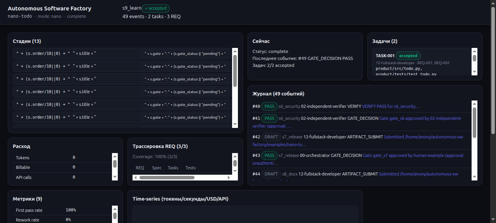
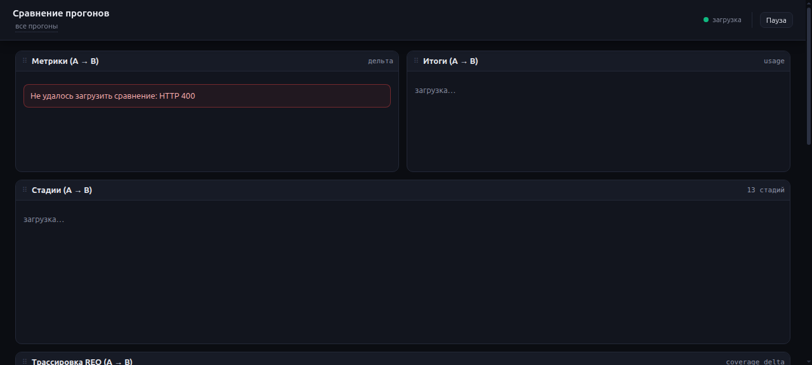
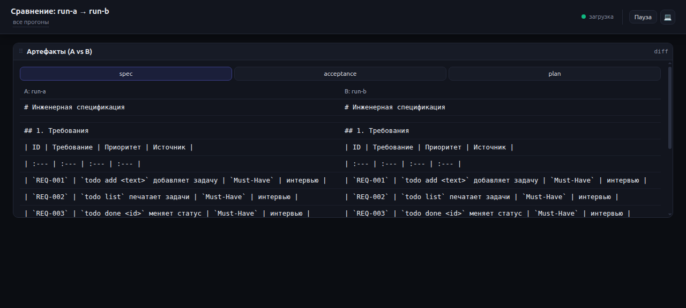
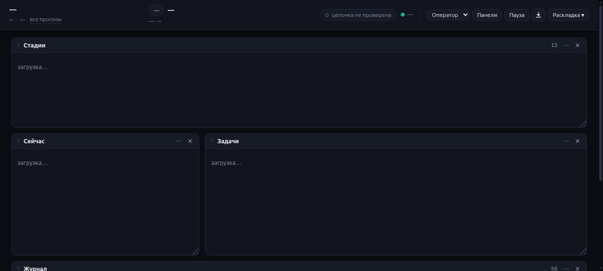
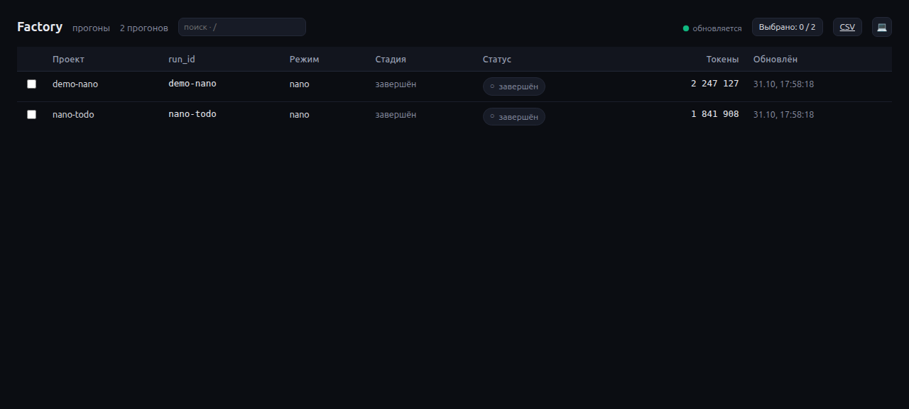

# Autonomous Software Factory

[](https://github.com/DenisZakharov2/autonomous-sw-factory/actions/workflows/ci.yml)
[](LICENSE)
[](https://github.com/DenisZakharov2/autonomous-sw-factory/releases/tag/v1.0.13)

[Русский README](README.md) · [License](LICENSE) · [Reference run](examples/nano-todo/) · [Technical docs](TECHNICAL.md) · [Quick start](docs/quickstart.md)

---

**Version 1.0.13.**

## What this is in plain words

**Autonomous Software Factory** is a toolkit and a set of rules that turn chaotic development into a clear, verifiable process. It walks you from an idea to a working product through explicit stages: interview, requirements, architecture, build, acceptance, release, documentation, and lessons.

Every stage has a document to submit, a check to pass, and an explicit decision — proceed or send it back.

### Why this exists

If you've ever started a project and got lost — what to do next, how not to miss something important, how to know when the result is actually ready — the Factory solves exactly that problem. It doesn't write code for you; it asks the right questions in the right order and forces you to record answers before moving on.

### How it works in practice

1. **Create a run** — an isolated folder for your project
2. **Get the first work order** — the Factory says: "Now it's the interview stage, fill out these two templates"
3. **Fill the templates** — answer questions in plain language, no jargon
4. **Submit for review** — an independent verifier checks completeness and gives PASS or FAIL
5. **Close the gate** — a human (you or the customer) confirms: "Yes, accepted, let's continue"
6. **Repeat for all stages** — through release and documentation

At any point you can stop, check status, see where you're stuck, and continue tomorrow or next week — nothing gets lost.

---

## Who this is for

| If you are… | The factory gives you… |
|---|---|
| Founder or small team with an idea but no process | End-to-end process from interview to release |
| Team with a stuck project, no energy to finish | `brownfield` mode: audit, backup, targeted tasks, no rewrite from scratch |
| Customer who needs a report of what was checked and by whom | `AUDIT_TRAIL.md` from the journal: who, when, what submitted, what verdict |
| Team lead or auditor who needs the decision trail | Hash chain, signed checkpoints (`factory sign`), requirements traceability |
| Newcomer who needs questions without jargon and ready templates | Adaptive interview, role cards that forbid jargon, ready-made templates |

---

## What the Factory does NOT do (important to know upfront)

- **Does not write code fully autonomously** — it prepares documents, checks, and options, but you make the decision at every gate. The result won't need double-checking, but it won't appear without you either.
- **Does not replace Jira, Linear, or task trackers** — that's a different tool level.
- **Does not guarantee the model won't make mistakes** — the verifier catches obvious gaps, but doesn't vouch for the model's intelligence.
- **Does not auto-merge to main without a human** — release is always behind a human gate.
- **Does not work with non-git folders in brownfield mode** — for those cases use `standard` and back up manually.

---

## Modes

| Mode | Use case | Roles |
|---|---|---|
| `nano` | Smallest product, one developer | 4 |
| `standard` | Product team: PO, analysts, architect, fullstack, QA, security, DevOps | 12 |
| `enterprise` | Full roster: mobile, DBA, data engineer, tech writer, SRE | 22 |
| `brownfield` | Work on existing code (mandatory backup + restore drill) | 12 |

Start with `nano` — it's the simplest way to see how it all works on a live example.

---

## What's inside (brief)

- **22 role cards** — each knows its purpose, inputs, procedure, outputs, DoD, vetoes, escalation
- **13 stages** — from intake (`s_in` / `s00_intake`) to lessons (`s9_learn`) with explicit gates
- **Python engine** — `init`, `next`, `submit`, `gate`, `verify`, `task`, `quarantine`, `trace`, `metrics`, `usage`, `doctor`
- **`factory run` runtime** — loop: order → executor → verify → submit → gate. Executors: `fake` (for tests), `hermes`, `opencode`. Real CLIs run in `bwrap` sandbox
- **Signed checkpoints** — `factory sign` places HMAC checkpoint outside run folder; history tampering is detected
- **Eval set & comparison** — `factory eval` runs 6 reference cases, checks against baseline; `factory compare` shows delta of two runs
- **Hash-chained journal** — SHA-256, protects against accidental edits and naive tampering
- **Independent verifier** — PASS only from `02-independent-verifier`; human can accept risk as separate event
- **Skill quarantine** — SkillSpector with fail-closed and hash lock before installing third-party skills
- **Run dashboard** — `factory ui`: local read-only console, 9 panels, free grid, CSV/`.xlsx` export, run comparison
- **39 templates and 13 JSON schemas** — templates never pre-fill PASS
- **Reference run** — `examples/nano-todo/`: 49 events, 2 tasks, 3 requirements with tests, all gates passed, product runs

Numbers: 4 modes (all 4 exercised on real runs), 6 reference cases, 398 tests, CI on Ubuntu, macOS, Windows (Python 3.10–3.13).






---

## See a run

```bash
pip install "autonomous-sw-factory[xlsx]"
factory ui --runs-dir examples --open     # http://127.0.0.1:8420
```

The dashboard is read-only: it shows runs under `examples/` and writes nothing there.



---

## Quick start (minimal)

```bash
# 1. Install and check environment
python3 -m venv .venv && . .venv/bin/activate
pip install -e ".[dev]"
factory doctor

# 2. Create a run and get the first work order
factory init --run-id demo-01 --mode nano --idea "dependency-free CLI todo"
factory next --run-id demo-01

# 3. Take templates, fill declared documents, submit them
cp factory/templates/interview-brief.tmpl runs/demo-01/artifacts/interview-brief.md
cp factory/templates/GLOSSARY.tmpl runs/demo-01/artifacts/GLOSSARY.md
factory submit --run-id demo-01 --stage s00_intake \
  --role 01-smart-interviewer \
  --artifact artifacts/interview-brief.md \
  --artifact artifacts/GLOSSARY.md
factory verify --run-id demo-01 --stage s00_intake

# 4. Close the human gate
factory gate approve --run-id demo-01 --gate gate_s00 \
  --approver human:your-name --evidence "brief accepted"

# 5. Walk remaining stages by hand or with an executor
factory run --run-id demo-01 --executor fake --max-steps 60
```

`factory next` prints the work order: stage, role, which documents to submit, who reviews them, and which command closes the stage. A human or executor fills templates, submits them, the verifier returns a verdict. `factory run` does the same in a loop and stops at a human gate with exit code `2`, printing the exact command for the human.

Check the reference run without a model:

```bash
FACTORY_ROOT="$PWD/examples/nano-todo" \
FACTORY_RUNS_ROOT="$PWD/examples" \
factory verify --run-id nano-todo --stage s9_learn --require-gate
```

Expected: `VERIFY OK`. The reference run has 49 events, 2 tasks, 3 requirements with tests; the product runs.

---

## Key commands (cheat sheet)

| Command | Purpose |
|---|---|
| `factory doctor` | Check config, roles, schemas, templates, version, license |
| `factory init --run-id ID --mode MODE` | Create an isolated run |
| `factory status --run-id ID` | Show stage, gates, tasks, journal |
| `factory next --run-id ID` | Print next work order as JSON |
| `factory run --run-id ID --executor fake\|hermes\|opencode` | Run the loop. Exit codes: `0` done, `2` human needed, `3` escalation |
| `factory submit --run-id ID --stage S --role R --artifact P` | Submit producer artifacts |
| `factory verify --run-id ID [--stage S] [--require-gate]` | Deterministic verification |
| `factory sign --run-id ID --key-file KEY` | Sign journal head with HMAC checkpoint outside `runs/` |
| `factory gate approve\|reject\|accept-risk --gate G --approver human:ID` | Gate decision; `accept-risk` closes escalation with recorded risk |
| `factory trace --run-id ID` | `REQ → task → test → acceptance` matrix |
| `factory metrics --run-id ID [--write]` | Eight run health metrics |
| `factory eval --cases eval/cases [--executor fake] [--json]` | Run eval cases, check invariants and baseline |
| `factory compare --left ID --right ID [--json]` | Delta of two runs: stages, steps, tokens, cost, artifact hashes |
| `factory usage --run-id ID [--by stage\|task\|role] [--json]` | Spend from `runtime/usage.jsonl`; `null` is not turned into zero |
| `factory ui [serve] [--runs-dir D] [--port P] [--open]` | Local run dashboard: read-only, `GET` only, `127.0.0.1` only |

Full list — `factory --help`.

---

## Journal and trust

`blackbox.jsonl` is the single source of truth. Each event carries an ID, sequence, timestamp, stage, task, role, model, why, for_what, action, artifact hashes, verdict, and link to previous event.

What this gives you:
- Parallel roles cannot corrupt the chain (serialized via `fcntl.flock`)
- Tail truncation is visible (`state.json` stores last hash and event count)
- Artifact substitution after submission is caught as `artifact tampered` (re-hashing on `verify`)
- Producer cannot PASS their own work — rejected both at append and at verification
- `AUDIT_TRAIL.md` is rendered from JSONL for customer/auditor handoff

The chain itself is **not signed**: it detects accidental edits and naive tampering, not a determined attacker who recomputes every hash. For that threat model there is `factory sign` — an HMAC checkpoint outside `runs/`.

---

## Skill quarantine (supply chain security)

```bash
factory quarantine scan ./skills/my-skill \
  --name my-skill --pack local --commit local --license MIT \
  --lock skills-lock.json --no-llm
```

Scanner decision table:

| Recommendation | Conditions | Exit code | Action |
|---|---|---|---|
| `SAFE` | complete, coverage ≥ 95% | 0 | `AUTO_ALLOW`, write lock |
| `CAUTION` | complete | 0 | `ESCALATE_HUMAN` |
| `DO_NOT_INSTALL` | any | 0 | `REJECT_AND_PURGE` |
| any | incomplete / failed analyzer | any | `BLOCK_INCOMPLETE` |
| any | complete | ≠ 0 | `BLOCK_RETRY` |

Lock stores directory hash, pack, commit, license, scanner version, verdict. `factory quarantine verify-lock` recomputes the hash and detects a substituted file.

---

## Limitations (honest and upfront)

- `models.yaml` intentionally contains no vendor model IDs. Tiers resolve through the runtime or `FACTORY_MODEL_TIER_1/2/3`; the journal records the actual `model_id` the runtime passed.
- Cost in `metrics` stays `null`: `cost_per_artifact_usd` is computed from the journal, but the journal doesn't store prices. Runtime writes tokens and cost separately in `runtime/usage.jsonl`.
- `Brownfield` supports git repositories only. For a folder without git, use `standard` and back up manually.
- `s4_build` imports tasks from `plan.md` Markdown table; arbitrary plan formats are not parsed.
- `examples/nano-todo` is a deterministic reference run, not proof of model autonomy.
- `factory run` executes one step per executor call and stops at a human gate.
- The hash chain is not signed; signing is a separate `factory sign` command, no auto-signing in `factory run`.
- Token/time/money budgets are **guardrails**, not measured cost. `enterprise` is a calculated budget, never measured on real Hermes.
- `factory metrics` returns `cost_per_artifact_usd: null` until the runtime writes tokens and price. Don't quote an estimate as fact.

---

## Development

```bash
pip install -e ".[dev]"
pytest -q
factory doctor
python examples/build_nano_todo.py
```

CI: Python 3.10–3.13, `doctor`, `pytest`, example check, package build.

---

## License

MIT. See [LICENSE](LICENSE) and [NOTICE](NOTICE).