# Autonomous Software Factory

[](https://github.com/DenisZakharov2/autonomous-sw-factory/actions/workflows/ci.yml)
[](LICENSE)
[](https://github.com/DenisZakharov2/autonomous-sw-factory/releases/tag/v1.0.9)

[Русский README](README.md) · [License](LICENSE) · [Reference run](examples/nano-todo/) · [Technical docs](TECHNICAL.md) · [Quick start](docs/quickstart.md)

---

**Version 1.0.9.**

## See a run

```bash
pip install "autonomous-sw-factory[xlsx]"
factory ui --runs-dir examples --open     # http://127.0.0.1:8420
```

The dashboard is read-only: it shows runs under `examples/` and writes nothing there.


---

## Why this exists

**Autonomous Software Factory** is a toolkit and a set of rules that turn chaotic development into a clear, verifiable process. It walks you from an idea to a working product through explicit stages: interview, requirements, architecture, build, acceptance, release, documentation, and lessons.

Every stage has a document to submit, a check to pass, and an explicit decision — proceed or send it back.

### Convenient — because the process leads you, not the other way around

The factory asks the questions and adapts its language to your level:
- **Newcomer** gets plain words, step by step, with recommended options
- **Manager** sees options, constraints, and budgets
- **Developer** gets files, templates, and exact commands

One process — three different languages.


### Safe — because the author doesn't accept their own work

Only an independent verifier can record `PASS`. The producer — the one who wrote the code or document — physically cannot close their own gate.

Real executors (Hermes, OpenCode, Claude Code) run in a sandbox:
- Filesystem root is read-only
- Control files (`state.json`, journal, evidence) are mounted read-only
- Writes are only allowed in directories declared by the work order

Before touching existing code (`brownfield` mode), the factory creates a full backup, verifies restore in a separate clone, and only then allows edits.

### Transparent and verifiable — because everything stays as files

- Every stage leaves a document from a template
- Every requirement links to a task and a test (`factory trace`)
- Journal keeps a SHA-256 hash chain — tampering is caught automatically
- Token, time, and money spend is visible by stage and task (`factory usage`)
- A run can be archived, handed to a colleague, and verified later — not in chat, but as files


---

## Who this is for

| If you are… | The factory gives you… |
|---|---|
| Founder or small team with an idea but no process | End-to-end process from interview to release |
| Team with a stuck project, no energy to finish | `brownfield` mode: audit, backup, targeted tasks, no rewrite from scratch |
| Customer who needs a report of what was checked and by whom | `AUDIT_TRAIL.md` from the journal: who, when, what submitted, what verdict |
| Team lead or auditor who needs the decision trail | Hash chain, signed checkpoints (`factory sign`), requirements traceability |
| Newcomer who needs questions without jargon and ready templates | Adaptive interview, role cards that forbid jargon, ready-made templates |

**Not for you** if:
- You want a chat that writes code without a human
- This is a throwaway prototype nobody will accept
- You're not willing to write requirements and architecture

---

## What it looks like in practice

```bash
# 1. Install and check environment
python3 -m venv .venv && . .venv/bin/activate
pip install -e ".[dev]"
factory doctor

# 2. Create a run and get the first work order
factory init --run-id demo-01 --mode nano --idea "dependency-free CLI todo"
factory next --run-id demo-01

# 3. Take templates, fill declared documents, submit them
cp factory/templates/interview-brief.tmpl runs/demo-01/artifacts/interview-brief.md
cp factory/templates/GLOSSARY.tmpl runs/demo-01/artifacts/GLOSSARY.md
factory submit --run-id demo-01 --stage s00_intake \
  --role 01-smart-interviewer \
  --artifact artifacts/interview-brief.md \
  --artifact artifacts/GLOSSARY.md
factory verify --run-id demo-01 --stage s00_intake

# 4. Close the human gate
factory gate approve --run-id demo-01 --gate gate_s00 \
  --approver human:your-name --evidence "brief accepted"

# 5. Walk remaining stages by hand or with an executor
factory run --run-id demo-01 --executor fake --max-steps 60
```

`factory next` prints the work order: stage, role, which documents to submit, who reviews them, and which command closes the stage. A human or executor fills templates, submits them, the verifier returns a verdict. `factory run` does the same in a loop and stops at a human gate with exit code `2`, printing the exact command for the human.

Check the reference run without a model:

```bash
FACTORY_ROOT="$PWD/examples/nano-todo" \
FACTORY_RUNS_ROOT="$PWD/examples" \
factory verify --run-id nano-todo --stage s9_learn --require-gate
```

Expected: `VERIFY OK`. The reference run has 49 events, 2 tasks, 3 requirements with tests; the product runs.

---

## What's inside

| Component | What it is |
|---|---|
| **22 role cards** | Purpose, inputs, procedure, outputs, DoD, veto, prohibitions, escalation |
| **13 stages** | From `s_in`/`s00_intake` to `s9_learn` with explicit gates |
| **Python engine** | `init`, `next`, `submit`, `gate`, `verify`, `task`, `quarantine`, `trace`, `metrics`, `usage`, `doctor` |
| **`factory run` runtime** | Order → executor → verify → submit → gate; `pending_artifacts`, `next_role`, `usage.jsonl`, evidence, stop-guards. Executors: `fake`, `hermes`, `opencode`. Real CLIs in `bwrap`, control plane read-only |
| **Signed checkpoints** | `factory sign` — HMAC-SHA256 of journal head outside `runs/`; `factory verify` tells `stale` from `rolled_back` and `diverged` |
| **Eval set & comparison** | `factory eval` runs 6 reference cases, checks against baseline, fails on regression; `factory compare` shows delta of two runs by stages, cost, artifact hashes |
| **Hash-chained journal** | SHA-256, `fcntl.flock`, state anchor, semantic `PASS` checks |
| **Independent verifier** | `PASS` only from `02-independent-verifier`; human can accept risk as separate event |
| **Skill quarantine** | SkillSpector 2.12.0 with fail-closed and hash lock |
| **Run dashboard** | `factory ui` — local read-only console: 9 panels, free 12-column grid, presets, CSV/`.xlsx` export, 2s polling, SSE, run comparison |
| **Templates & schemas** | 39 templates and 13 JSON schemas; templates never pre-fill `PASS` |
| **Reference run** | `examples/nano-todo/`: 49 events, 2 tasks, 3 REQ, all gates passed, product runs |

Numbers: 4 modes (3 exercised on a real project), 6 reference cases, 398 tests, CI on Ubuntu, macOS, Windows (Python 3.10–3.13).


---

## Modes

| Mode | Roles | Use case |
|---|---|---|
| `nano` | 4 | Interviewer/spec-author, fullstack builder, verifier, orchestrator. Smallest product. |
| `standard` | 12 | Product team: PO, analysts, architect, fullstack, QA, security, DevOps. |
| `enterprise` | 22 | All roles, including mobile, DBA, data engineer, tech writer, SRE. |
| `brownfield` | 12 | Standard plus mandatory backup/restore drill before first write. |

In `nano`, role `01-smart-interviewer` also writes `spec.md`, `spec-human.md`, `traceability.json` and `plan.md`, because roles `05` and `04` are not active. This is encoded in the role card and checked by `factory doctor`.

---

## Stages and gates

```mermaid
graph TD
    subgraph "Intake & prep"
        s_in["s_in: backup, restore drill, brownfield audit"] -->|human| gate_s_in["gate_s_in"]
        s00["s00_intake: interview, glossary"] -->|human| gate_s00["gate_s00"]
        s0["s0_vision: vision, backlog, competitors, metrics"] -->|human advisory| gate_s0["gate_s0"]
    end

    subgraph "Spec & quarantine"
        s1["s1_spec: spec, spec-human, traceability, domain model, access matrix"] -->|human blocking| gate_s1["gate_s1"]
        s15["s15_quarantine: skill security review, skills-lock"] -->|verifier| gate_s15["gate_s15"]
    end

    subgraph "Architecture & plan"
        s2["s2_architecture: architecture, API contract, data model, threat model, ADR, UX, AI design"] -->|verifier| gate_s2["gate_s2"]
        s3["s3_plan: plan, tech debt"] -->|verifier| gate_s3["gate_s3"]
    end

    subgraph "Build & acceptance"
        s4["s4_build: deliverables, code, tests"] -->|verifier| gate_s4["gate_s4"]
        s5["s5_acceptance: test report, acceptance matrix"] -->|verifier| gate_s5["gate_s5"]
    end

    subgraph "Security & release"
        s6["s6_security: app security, DB report, data pipeline"] -->|verifier| gate_s6["gate_s6"]
        s7["s7_release: deploy runbook, ops runbook, release notes"] -->|human| gate_s7["gate_s7"]
    end

    subgraph "Docs & lessons"
        s8["s8_docs: product README, user guide"] -->|verifier| gate_s8["gate_s8"]
        s9["s9_learn: metrics, lessons learned, improvement patches"] -->|human| gate_s9["gate_s9"]
    end

    gate_s_in --> s00
    gate_s00 --> s0
    gate_s0 --> s1
    gate_s1 --> s15
    gate_s15 --> s2
    gate_s2 --> s3
    gate_s3 --> s4
    gate_s4 --> s5
    gate_s5 --> s6
    gate_s6 --> s7
    gate_s7 --> s8
    gate_s8 --> s9

    classDef humanGate fill:#fef3c7,stroke:#f59e0b,stroke-width:2px;
    classDef verifierGate fill:#d1fae5,stroke:#10b981,stroke-width:2px;
    classDef stage fill:#e0e7ff,stroke:#6366f1,stroke-width:1px;

    class gate_s_in,gate_s00,gate_s0,gate_s1,gate_s7,gate_s9 humanGate;
    class gate_s15,gate_s2,gate_s3,gate_s4,gate_s5,gate_s6,gate_s8 verifierGate;
    class s_in,s00,s0,s1,s15,s2,s3,s4,s5,s6,s7,s8,s9 stage;
```




---

## Key commands

| Command | Purpose |
|---|---|
| `factory doctor` | Check config, roles, schemas, templates, version, license |
| `factory init --run-id ID --mode MODE` | Create an isolated run |
| `factory status --run-id ID` | Show stage, gates, tasks, journal |
| `factory next --run-id ID` | Print next work order as JSON |
| `factory run --run-id ID --executor fake\|hermes\|opencode` | Run the loop. Exit codes: `0` done, `2` human needed, `3` escalation |
| `factory submit --run-id ID --stage S --role R --artifact P` | Submit producer artifacts |
| `factory verify --run-id ID [--stage S] [--require-gate]` | Deterministic verification |
| `factory sign --run-id ID --key-file KEY` | Sign journal head with HMAC checkpoint outside `runs/` |
| `factory gate approve\|reject\|accept-risk --gate G --approver human:ID` | Gate decision; `accept-risk` closes escalation with recorded risk |
| `factory trace --run-id ID` | `REQ → task → test → acceptance` matrix |
| `factory metrics --run-id ID [--write]` | Eight run health metrics |
| `factory eval --cases eval/cases [--executor fake] [--json]` | Run eval cases, check invariants and baseline |
| `factory compare --left ID --right ID [--json]` | Delta of two runs: stages, steps, tokens, cost, artifact hashes |
| `factory usage --run-id ID [--by stage\|task\|role] [--json]` | Spend from `runtime/usage.jsonl`; `null` is not turned into zero |
| `factory ui [serve] [--runs-dir D] [--port P] [--open]` | Local run dashboard: read-only, `GET` only, `127.0.0.1` only |

Full list — `factory --help`.

---

## Journal and trust

`blackbox.jsonl` is the single source of truth. Each event carries `event_id`, `seq`, `timestamp_utc`, stage, task, role, model, `why`, `for_what`, `action`, artifact hashes, verdict, `prev_hash` and `hash`.

Guarantees:
- Writes serialized via `fcntl.flock` — parallel roles cannot corrupt the chain
- `state.json` stores last hash and event count — tail truncation is visible
- `submit`, `gate approve`, `task accept`, `artifact re-record` bind SHA-256 hashes; `factory verify` re-hashes files on disk — a change after submission is caught as `artifact tampered`
- Producer `PASS` is rejected both at append time and at verification time
- `AUDIT_TRAIL.md` is rendered from JSONL with escaping
- The chain itself is **not signed**: it detects accidental edits and naive tampering, not a determined attacker who recomputes every hash. For that threat model there is `factory sign` — an HMAC checkpoint outside `runs/`.

---

## Skill quarantine

```bash
factory quarantine scan ./skills/my-skill \
  --name my-skill --pack local --commit local --license MIT \
  --lock skills-lock.json --no-llm
```

Decision table:

| `recommendation` | `is_complete` | exit code | Action |
|---|---|---|---|
| `SAFE` | `true`, coverage ≥ 95 | 0 | `AUTO_ALLOW`, write lock |
| `CAUTION` | `true` | 0 | `ESCALATE_HUMAN` |
| `DO_NOT_INSTALL` | any | 0 | `REJECT_AND_PURGE` |
| any | `false` / failed analyzer | any | `BLOCK_INCOMPLETE` |
| any | `true` | ≠ 0 | `BLOCK_RETRY` |

Lock stores `pack`, `commit`, `path`, directory `sha256`, `license`, scanner version, `severity`, `recommendation`, `is_complete`, `coverage_percent`, `scanned_at`, `approved_by`. `factory quarantine verify-lock` recomputes the hash and detects a substituted file.

---

## Limitations

- `models.yaml` intentionally contains no vendor model IDs. Tiers resolve through the runtime or `FACTORY_MODEL_TIER_1/2/3`; the journal records the actual `model_id` the runtime passed.
- Cost in `metrics` stays `null`: `cost_per_artifact_usd` is computed from the journal, but the journal doesn't store prices. Runtime writes tokens and cost separately in `runtime/usage.jsonl`.
- `Brownfield` supports git repositories only. For a folder without git, use `standard` and back up manually.
- `s4_build` imports tasks from `plan.md`; arbitrary plan formats are not parsed.
- A full run requires a model or a human. `examples/nano-todo` is a deterministic reference run, not proof of model autonomy.
- `factory run` executes one step per executor call and stops at a human gate.
- The hash chain is not signed; signing is a separate `factory sign` command, no auto-signing in `factory run`.

---

## Development

```bash
pip install -e ".[dev]"
pytest -q
factory doctor
python examples/build_nano_todo.py
```

CI: Python 3.10–3.13, `doctor`, `pytest`, example check, package build.

---

## License

MIT. See [LICENSE](LICENSE) and [NOTICE](NOTICE).