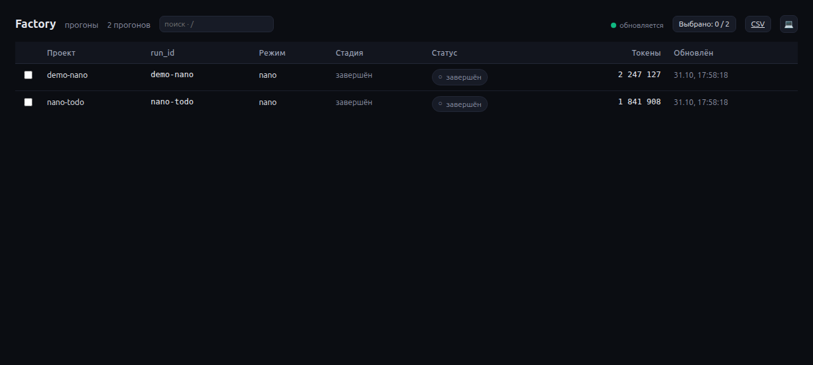
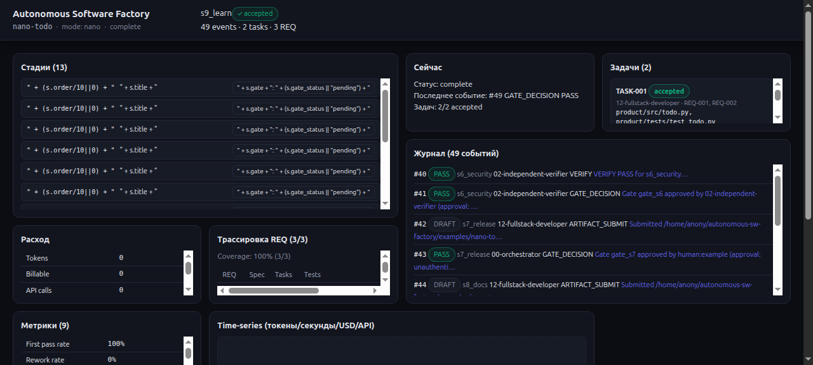
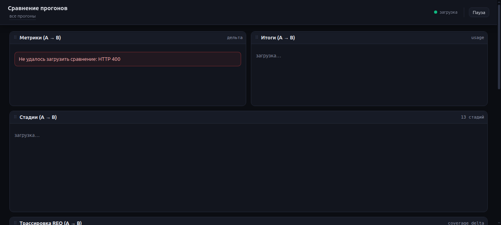
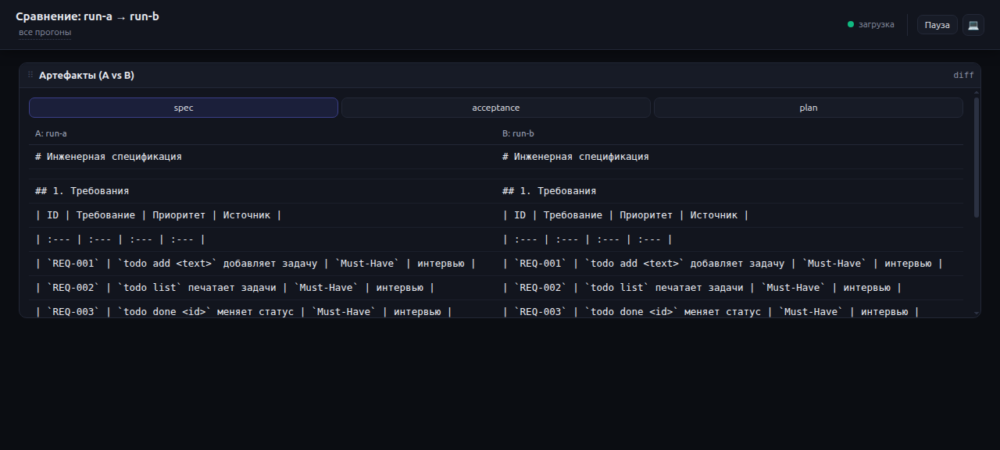
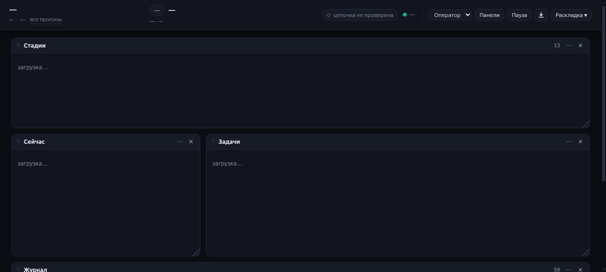

# Autonomous Software Factory

[](https://github.com/DenisZakharov2/autonomous-sw-factory/actions/workflows/ci.yml)
[](LICENSE)
[](https://github.com/DenisZakharov2/autonomous-sw-factory/releases/tag/v1.0.9)

[English README](README.en.md) · [Лицензия](LICENSE) · [Пример прогона](examples/nano-todo/) · [Техническая документация](TECHNICAL.md) · [Быстрый старт](docs/quickstart.md)

---

**Версия 1.0.9.**

## Посмотреть, как это работает

```bash
pip install autonomous-sw-factory
factory ui --runs-dir runs --open     # http://127.0.0.1:8420
```

Дашборд только для чтения: он показывает прогоны из `runs/` и ничего в них не пишет.



---

## Зачем это нужно

**Autonomous Software Factory** — это набор инструментов и правил, которые превращают хаотичную разработку в понятный, проверяемый процесс. Он ведёт вас от идеи до работающего продукта через чёткие этапы: интервью, техническое задание, архитектура, сборка, приёмка, релиз, документация и выводы.

На каждом этапе есть документ, который сдаётся и проверяется, и явное решение — продолжить или вернуть на доработку.

### Это удобно, потому что процесс ведёт вас, а не наоборот

Фабрика сама задаёт вопросы и подстраивает язык под ваш уровень подготовки:
- **Новичку** объясняет без жаргона, по шагам, с рекомендациями
- **Руководителю** показывает варианты, ограничения и бюджет
- **Разработчику** отдаёт файлы, шаблоны и точные команды

Один процесс — три разных языка.



### Это безопасно, потому что автор не принимает свою работу

Поставить `PASS` может только независимый верификатор. Продюсер — тот, кто писал код или документ — физически не может закрыть свой же гейт.

Реальные исполнители (Hermes, OpenCode, Claude Code) работают в песочнице:
- Корень файловой системы — только для чтения
- Управляющие файлы (`state.json`, журнал, evidence) — смонтированы read-only
- Запись разрешена только в каталоги, объявленные в задании

Перед работой с чужим кодом (режим `brownfield`) фабрика создаёт полный бэкап, проверяет восстановление в отдельном клоне и только потом разрешает правки.

### Это честно: контекст не обрезается втихую

Фабрика не подаёт исполнителю обрезанное вслепую сообщение. Перед каждой ролью
считается размер собственных артефактов плюс RAG-фрагментов из репозитория.
Если сумма не влезает в окно модели (`max_tokens × 4 символа × 0,75`, tier из
карточки роли через `factory/models.yaml`), прогон останавливается с ошибкой
`context_exceeded` и требует дробить задачу на подзадачи — вместо того чтобы
промолчально обрезать промпт и получить ложный результат.

Максимальные размеры по тирам:
- `tier-1-economy` (8192 токенов): 24 576 символов
- `tier-2-balanced` (32 768 токенов): 98 304 символа
- `tier-3-frontier` (131 072 токена): 393 216 символов

Это преимущество перед чатами, которые молча режут контекст и теряют инструкции
или требования из середины сообщения.

### Это прозрачно и проверяемо, потому что всё остаётся файлами

- Каждый этап оставляет документ по шаблону
- Каждое требование связано с задачей и тестом (`factory trace`)
- Журнал хранит хеш-цепочку SHA-256 — подмена ловится автоматически
- Расход токенов, времени и денег виден по стадиям и задачам (`factory usage`)
- Прогон можно заархивировать, передать коллеге и проверить позже — не в чате, а файлами



---

## Кому это подойдёт

| Если вы… | Фабрика даст… |
|---|---|
| Основатель или маленькая команда с идеей, но без процесса | Готовый процесс «под ключ» от интервью до релиза |
| Команда с застрявшим проектом, нет сил довести | Режим `brownfield`: аудит, бэкап, точечные задачи, без переписывания с нуля |
| Заказчику нужен отчёт «что и кем проверено» | `AUDIT_TRAIL.md` из журнала: кто, когда, что сдал, какой вердикт |
| Тимлид или аудитор, важен след решения | Хеш-цепочка, подписанные чекпоинты (`factory sign`), трассировка требований |
| Новичок, нужны вопросы без жаргона и шаблоны | Адаптивное интервью, карточки ролей с запретом жаргона, готовые шаблоны |

**Не подойдёт**, если:
- Нужен чат, который пишет код без человека — фабрика **не полностью автономная**: она готовит документы, проверки и варианты, но решение на каждом гейте принимаете вы, поэтому результат не придётся перепроверять за двумя
- Это разовый прототип, который никто не будет принимать
- Нет готовности писать ТЗ и архитектуру

---

## Как это выглядит на практике

```bash
# 1. Поставить и проверить окружение
python3 -m venv .venv && . .venv/bin/activate
pip install -e ".[dev]"
factory doctor

# 2. Создать прогон и получить первое задание
factory init --run-id demo-01 --mode nano --idea "CLI todo без зависимостей"
factory next --run-id demo-01

# 3. Взять шаблоны, заполнить документы и сдать их
cp factory/templates/interview-brief.tmpl runs/demo-01/artifacts/interview-brief.md
cp factory/templates/GLOSSARY.tmpl runs/demo-01/artifacts/GLOSSARY.md
factory submit --run-id demo-01 --stage s00_intake \
  --role 01-smart-interviewer \
  --artifact artifacts/interview-brief.md \
  --artifact artifacts/GLOSSARY.md
factory verify --run-id demo-01 --stage s00_intake

# 4. Закрыть человеческие ворота
factory gate approve --run-id demo-01 --gate gate_s00 \
  --approver human:your-name --evidence "brief accepted"

# 5. Пройти остальные этапы: руками или исполнителем
factory run --run-id demo-01 --executor fake --max-steps 60
```

`factory next` печатает задание: этап, роль, какие документы сдать, кто проверяет и какой командой закрывается этап. Человек или исполнитель заполняет шаблоны, сдаёт их, верификатор выносит вердикт. `factory run` делает то же самое в цикле и останавливается на человеческих воротах с кодом `2`, печатая точную команду для человека.

Проверить эталонный прогон без модели:

```bash
FACTORY_ROOT="$PWD/examples/nano-todo" \
FACTORY_RUNS_ROOT="$PWD/examples" \
factory verify --run-id nano-todo --stage s9_learn --require-gate
```

Ожидаемо: `VERIFY OK`. В эталоне 49 событий, 2 задачи, 3 требования с тестами; продукт запускается.

---

## Что внутри

| Компонент | Что это |
|---|---|
| **22 ролевые карты** | Назначение, входы, процедура, выходы, DoD, вето, запреты, эскалация |
| **13 стадий** | От `s_in`/`s00_intake` до `s9_learn` с явными гейтами |
| **Python-движок** | `init`, `next`, `submit`, `gate`, `verify`, `task`, `quarantine`, `trace`, `metrics`, `usage`, `doctor` |
| **Рантайм `factory run`** | Задание → исполнитель → проверка → сдача → гейт; `pending_artifacts`, `next_role`, `usage.jsonl`, evidence, стоп-гарды. Исполнители: `fake`, `hermes`, `opencode`. Реальные CLI в `bwrap`, управляющая плоскость read-only |
| **Подписанные чекпоинты** | `factory sign` — HMAC-SHA256 головы журнала вне `runs/`; `factory verify` отличает `stale` от `rolled_back` и `diverged` |
| **Eval-набор и сравнение** | `factory eval` гоняет 5 эталонных кейсов, сверяет с baseline, падает при регрессии; `factory compare` показывает дельту двух прогонов по стадиям, стоимости, хешам артефактов |
| **Журнал с хеш-цепочкой** | SHA-256, `fcntl.flock`, state-якорь, семантическая проверка `PASS` |
| **Независимый верификатор** | `PASS` только от `02-independent-verifier`; человек может принять риск отдельным событием |
| **Карантин скиллов** | SkillSpector 2.12.0 с fail-closed и локом хешей |
| **Дашборд прогона** | `factory ui` — локальный read-only пульт: 9 панелей, свободная сетка 12 колонок, пресеты, экспорт CSV/`.xlsx`, опрос 2 с, SSE, сравнение прогонов |
| **Шаблоны и схемы** | 38 шаблонов и 13 JSON-схем; шаблоны не ставят `PASS` заранее |
| **Эталонный прогон** | `examples/nano-todo/`: 49 событий, 2 задачи, 3 REQ, все гейты пройдены, продукт запускается |

Цифры: 4 режима (3 проверены на реальном проекте), 5 эталонных примеров, 398 тестов, CI на Ubuntu, macOS, Windows (Python 3.10–3.13).



---

## Режимы

| Режим | Ролей | Для чего |
|---|---|---|
| `nano` | 4 | Интервьюер/spec-author, fullstack-разработчик, верификатор, оркестратор. Минимальный продукт. |
| `standard` | 12 | Продуктовая команда: PO, аналитики, архитектор, fullstack, QA, security, DevOps. |
| `enterprise` | 22 | Все роли, включая mobile, DBA, data engineer, tech writer, SRE. |
| `brownfield` | 12 | Standard + обязательный backup/restore drill до первой записи. |

В `nano` роль `01-smart-interviewer` дополнительно пишет `spec.md`, `spec-human.md`, `traceability.json` и `plan.md`, потому что ролей `05` и `04` в нём нет. Это зафиксировано в карточке роли и проверяется `factory doctor`.

---

## Стадии и гейты

```mermaid
graph LR
    subgraph "Вход"
        s_in["s_in<br/>бэкап, restore drill"]:::stage
        s00["s00_intake<br/>интервью, глоссарий"]:::stage
        s0["s0_vision<br/>визион, бэклог"]:::stage
    end

    subgraph "Спецификация"
        s1["s1_spec<br/>spec, traceability, domain model"]:::stage
        s15["s15_quarantine<br/>skill security review"]:::stage
    end

    subgraph "Архитектура и план"
        s2["s2_architecture<br/>arch, API, threat model, ADR"]:::stage
        s3["s3_plan<br/>план, техдолг"]:::stage
    end

    subgraph "Сборка и приёмка"
        s4["s4_build<br/>код, тесты, deliverables"]:::stage
        s5["s5_acceptance<br/>test report, acceptance matrix"]:::stage
    end

    subgraph "Безопасность и релиз"
        s6["s6_security<br/>app sec, DB, data pipeline"]:::stage
        s7["s7_release<br/>runbooks, release notes"]:::stage
    end

    subgraph "Документация"
        s8["s8_docs<br/>README, user guide"]:::stage
        s9["s9_learn<br/>метрики, lessons, patches"]:::stage
    end

    %% Gates
    g_in["👤 gate_s_in"]:::humanGate
    g_00["👤 gate_s00"]:::humanGate
    g_0["👤 gate_s0<br/>(advisory)"]:::humanGate
    g_1["👤 gate_s1<br/>(blocking)"]:::humanGate
    g_15["✅ gate_s15"]:::verifierGate
    g_2["✅ gate_s2"]:::verifierGate
    g_3["✅ gate_s3"]:::verifierGate
    g_4["✅ gate_s4"]:::verifierGate
    g_5["✅ gate_s5"]:::verifierGate
    g_6["✅ gate_s6"]:::verifierGate
    g_7["👤 gate_s7"]:::humanGate
    g_8["✅ gate_s8"]:::verifierGate
    g_9["👤 gate_s9"]:::humanGate

    %% Flow
    s_in --> g_in --> s00 --> g_00 --> s0 --> g_0 --> s1 --> g_1 --> s15 --> g_15 --> s2 --> g_2 --> s3 --> g_3 --> s4 --> g_4 --> s5 --> g_5 --> s6 --> g_6 --> s7 --> g_7 --> s8 --> g_8 --> s9 --> g_9

    classDef stage fill:#1e293b,stroke:#3b82f6,stroke-width:2px,color:#e2e8f0,font-size:11px;
    classDef humanGate fill:#fef3c7,stroke:#f59e0b,stroke-width:2px,color:#78350f,font-weight:bold,font-size:10px;
    classDef verifierGate fill:#d1fae5,stroke:#10b981,stroke-width:2px,color:#064e3b,font-weight:bold,font-size:10px;

    linkStyle default stroke:#64748b,stroke-width:1.5px;
```





---

## Основные команды

| Команда | Назначение |
|---|---|
| `factory doctor` | Проверить конфиг, роли, схемы, шаблоны, версию и лицензию |
| `factory init --run-id ID --mode MODE` | Создать изолированный прогон |
| `factory status --run-id ID` | Показать стадию, гейты, задачи, журнал |
| `factory next --run-id ID` | Выдать следующее задание в JSON |
| `factory run --run-id ID --executor fake\|hermes\|opencode` | Исполнить цикл. Коды: `0` готово, `2` нужен человек, `3` эскалация |
| `factory submit --run-id ID --stage S --role R --artifact P` | Сдать артефакты продюсера |
| `factory verify --run-id ID [--stage S] [--require-gate]` | Детерминированная проверка |
| `factory sign --run-id ID --key-file KEY` | Подписать голову журнала HMAC-чекпоинтом вне `runs/` |
| `factory gate approve\|reject\|accept-risk --gate G --approver human:ID` | Решение гейта; `accept-risk` закрывает эскалацию с записью риска |
| `factory trace --run-id ID` | Матрица `REQ → task → test → acceptance` |
| `factory metrics --run-id ID [--write]` | Восемь метрик здоровья прогона |
| `factory eval --cases eval/cases [--executor fake] [--json]` | Прогнать eval-кейсы, сверить инварианты и baseline |
| `factory compare --left ID --right ID [--json]` | Дельта двух прогонов: стадии, шаги, токены, стоимость, хеши артефактов |
| `factory usage --run-id ID [--by stage\|task\|role] [--json]` | Расход из `runtime/usage.jsonl`; `null` не превращается в ноль |
| `factory ui [serve] [--runs-dir D] [--port P] [--open]` | Локальный дашборд: только чтение, только `GET`, только `127.0.0.1` |

Полный список — `factory --help`.

---

## Журнал и доверие

`blackbox.jsonl` — единственный источник истины. Каждое событие содержит `event_id`, `seq`, `timestamp_utc`, стадию, задачу, роль, модель, `why`, `for_what`, `action`, хеши артефактов, вердикт, `prev_hash` и `hash`.

Гарантии:
- Запись сериализована через `fcntl.flock` — параллельные роли не ломают цепочку
- `state.json` хранит последний хеш и число событий — усечение хвоста видно
- `submit`, `gate approve`, `task accept`, `artifact re-record` фиксируют SHA-256 артефактов; `factory verify` перехеширует файлы на диске — подмена после сдачи ловится как `artifact tampered`
- `PASS` от продюсера отклоняется и при записи, и при проверке
- `AUDIT_TRAIL.md` генерируется из JSONL с экранированием
- Сама цепочка **не подписана**: она защищает от случайной правки и наивной подмены, но не от злонамеренного пересчёта всей истории. Для сильной модели угроз есть `factory sign` — HMAC-контрольная точка вне `runs/`.

---

## Карантин скиллов

```bash
factory quarantine scan ./skills/my-skill \
  --name my-skill --pack local --commit local --license MIT \
  --lock skills-lock.json --no-llm
```

Решение:

| `recommendation` | `is_complete` | exit code | Действие |
|---|---|---|---|
| `SAFE` | `true`, coverage ≥ 95 | 0 | `AUTO_ALLOW`, запись локов |
| `CAUTION` | `true` | 0 | `ESCALATE_HUMAN` |
| `DO_NOT_INSTALL` | любое | 0 | `REJECT_AND_PURGE` |
| любое | `false` / упавший анализатор | любой | `BLOCK_INCOMPLETE` |
| любое | `true` | ≠ 0 | `BLOCK_RETRY` |

Лок хранит `pack`, `commit`, `path`, `sha256` каталога, `license`, версию сканера, `severity`, `recommendation`, `is_complete`, `coverage_percent`, `scanned_at`, `approved_by`. `factory quarantine verify-lock` пересчитывает хеш и обнаруживает подмену файла.

---

## Ограничения

- `models.yaml` намеренно не содержит вендорских ID. Тир разрешается рантаймом или переменными `FACTORY_MODEL_TIER_1/2/3`. Журнал записывает фактический `model_id`, который передал рантайм.
- Стоимость в `metrics` остаётся `null`: `cost_per_artifact_usd` считается по журналу, а журнал не хранит цены. Рантайм пишет токены и цену отдельно, в `runtime/usage.jsonl`.
- `Brownfield` поддерживает только git-репозитории. Для папки без git используйте `standard` и сделайте бэкап вручную.
- `s4_build` принимает задачи из `plan.md`; произвольный формат плана не парсится.
- Полный прогон требует модели или человека. `examples/nano-todo` — детерминированный reference run, а не доказательство автономности.
- `factory run` исполняет по одному шагу за вызов исполнителя и останавливается на человеческом гейте.
- Хеш-цепочка не подписана; подпись — отдельная команда `factory sign`, автоподписи в `factory run` нет.

---

## Разработка

```bash
pip install -e ".[dev]"
pytest -q
factory doctor
python examples/build_nano_todo.py
```

CI: Python 3.10–3.13, `doctor`, `pytest`, проверка примера и сборка пакета.

---

## Лицензия

MIT. См. [LICENSE](LICENSE) и [NOTICE](NOTICE).